# 京东云亚瑟

亚瑟采用高通 IPQ6018，4核 A53，力压一众联发科 MT7981B 双核 A53，咸鱼价格60左右，可谓是性价比拉满。

### 刷机路线

uboot → 刷第三方固件

进入 uboot 方法：

1. 断电
2. 按住 reset 按钮
3. 插入电源，红灯闪烁，直至变为蓝灯，松开 reset
4. 电脑修改固定 IP 192.168.1.2，浏览器访问 192.168.1.1

访问不通，可以尝试：

- IP 与光猫网段冲突，拔掉 WAN 口线
- 电脑换个 LAN 口
- 重新进入 uboot

### 刷机流程

登录路由器之后，可以在底部查看系统版本号，各版本刷 uboot 方式：

- 1.5.40.r2181：SSH
- 4.0.0.r4015：TTL、9008
- 4.3.0.r4211：9008
- 更高：未测试
- 直接硬改 EMMC

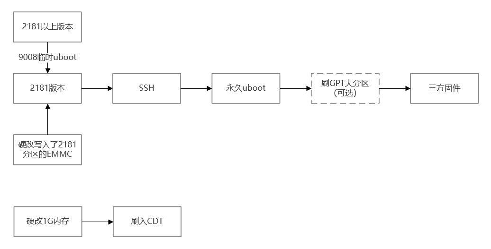

### 文件上传

开启后 SSH 后，即可使用 WinSCP 等工具，将文件上传到路由器

- 协议：SCP
- IP：路由器 IP，官方：192.168.68.1，三方固件可查看固件介绍，或者自动获取 IP 从网卡查看
- 端口：22
- 密码：路由器密码

# 固件

### lean - QWRT

- 闭源
- 内核版本 5.x
- 

俗称的大雕固件，总体用下来非常 OK


# SSH 刷入 uboot

登录路由器，F12 打开控制台，输入以下命令回车

```javascript
$.ajax({
    url: "/jdcapi",
    async: false,
    data: JSON.stringify({
        jsonrpc: "2.0",
        id: 1,
        method: "call",
        params: [
            $.cookie("sessionid"),
            "service",
            "set",
            {
                "name": "dropbear",
                "instances": {"instance1": {"command": ["/usr/sbin/dropbear"]}}
            }
        ]
    }),
    dataType: "json",
    type: "POST"
})
```

> [!TIP]
>
> 如果浏览器控制台无法粘贴的话，直接在 Console 输入 allow pasting 后 Enter 即可开启粘贴功能

使用 putty 等 SSH 连接到路由器（192.168.68.1:22），账号 root/管理页面密码：

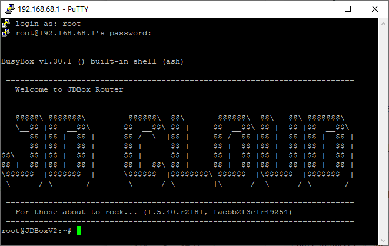

WinSCP 连接：

**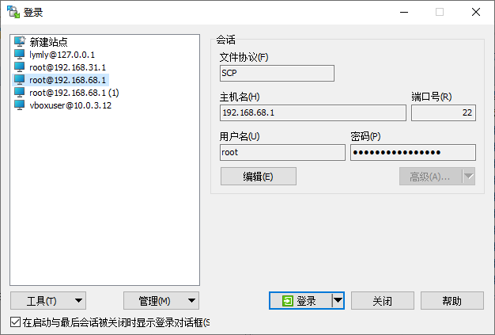**

将 uboot 文件（不死 uboot：uboot-JDC_AX1800_Pro-AX6600_Athena-20240510.bin）上传到路由器

刷写uboot到0:APPSBL和0:APPSBL_1分区：

```bash
root@JDBoxV2:~# dd if=/tmp/uboot-JDC_AX1800_Pro-AX6600_Athena-20240510.bin of=$(blkid -t PARTLABEL=0:APPSBL -o device) conv=fsync
1280+0 records in
1280+0 records out
655360 bytes (640.0KB) copied, 0.048256 seconds, 13.0MB/s
root@JDBoxV2:~# dd if=/tmp/uboot-JDC_AX1800_Pro-AX6600_Athena-20240510.bin of=$(blkid -t PARTLABEL=0:APPSBL_1 -o device) conv=fsync
1280+0 records in
1280+0 records out
655360 bytes (640.0KB) copied, 0.048341 seconds, 12.9MB/s
```

输入命令检查分区md5 hash值，和我这版2024.05.10编译的md5一致即可：

```bash
root@JDBoxV2:~# md5sum $(blkid -t PARTLABEL=0:APPSBL -o device) && md5sum $(blkid -t PARTLABEL=0:APPSBL_1 -o device)
5e1817f795ada48335fda9f22545a43e  /dev/mmcblk0p13
5e1817f795ada48335fda9f22545a43e  /dev/mmcblk0p14
```

> [Actions-OpenWrt/Tutorial/JDCloud-AX1800-Pro_AX6600-Athena.md at main · lgs2007m/Actions-OpenWrt · GitHub](https://github.com/lgs2007m/Actions-OpenWrt/blob/main/Tutorial/JDCloud-AX1800-Pro_AX6600-Athena.md)

# 降级刷入 uboot

已知最高 4211 版本可以利用高通 9008 从 uboot 刷入官方固件降级

1. 安装高通驱动 Qualcomm USB Driver v1.0.10061.1.exe

2. 双公头 USB 线连接电脑，USB短接主板背面触点，路由器通电，如果成功，设备管理器会出现`端口（COM 和 LPT）`

   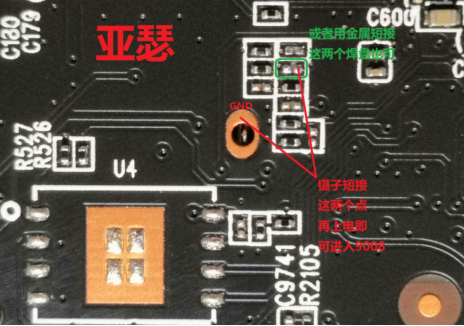

3. 执行`USB命令.bat`输入com口（设备管理器查看 9008 com 端口），回车，第一次执行成功的输出；观察“设备管理器”那里会刷新两次，再次出现 9008

4. 继续回车，第二次执行成功的输出（这次执行应该只需要几秒钟）。同时看灯，只要变红，立刻按住reset，闪烁的红灯变蓝灯，松开reset

5. 浏览器输入192.168.1.1 即可进入 uboot

6. 上传 2181 版本官方固件，刷入

7. 红灯常量后，修改电脑为自动获取 ip，访问 192.168.68.1

8. 执行[SSH 刷入 uboot](#SSH 刷入 uboot)中的步骤

> [!TIP]
>
> 由于此处刷入的是临时 uboot，所以最好降级后，用 SSH 方式刷入永久 uboot，方便后续刷三方固件。

> [【新提醒】亚瑟4211拆机9008免TTL刷uboot教程-京东云、网心云、玩客云等PCDN云设备-恩山无线论坛](https://www.right.com.cn/forum/thread-8386067-1-1.html)
>
> [【新提醒】京东云亚瑟&雅典娜恢复官方固件4.0.0.4015或者1.5.70.2242以及亚瑟原始分区文件-京东云、网心云、玩客云等PCDN云设备-恩山无线论坛](https://www.right.com.cn/FORUM/thread-8379578-1-1.html)
>
> [【新提醒】京东云亚瑟/雅典娜 通用的官方原厂固件-OPENWRT专版-恩山无线论坛](https://www.right.com.cn/forum/thread-8341657-1-1.html)

# 刷 GPT 大分区

此处大分区特指`rootfs`分区，系统固件就是刷入这个分区，原厂的分区只有60MB大小，不够刷入某些固件 + 后续安装软件。所以需要输入 GPT 分区表，将这个分区扩大，目前有现成的512MB、1024MB、2048MB分区表。

上传 GPT 分区表到路由器

```bash
# 检查md5
root@JDBoxV2:~# md5sum /tmp/gpt-JDC_*_dual-boot_rootfs*M_no-last-partition.bin
# 亚瑟gpt md5
9d9e3803ba541ff38449acd181026b28  /tmp/gpt-JDC_AX1800_Pro_dual-boot_rootfs512M_no-last-partition.bin
5aaf1b606458fbffc72342540db9bc52  /tmp/gpt-JDC_AX1800_Pro_dual-boot_rootfs1024M_no-last-partition.bin
b93b4823af2b4fc31d22c25468181e7a  /tmp/gpt-JDC_AX1800_Pro_dual-boot_rootfs2048M_no-last-partition.bin

# 刷入2G大分区
dd if=/tmp/gpt-JDC_AX1800_Pro_dual-boot_rootfs2048M_no-last-partition.bin of=/dev/mmcblk0 bs=512 count=34 conv=fsync
dd if=/dev/mmcblk0 bs=512 count=34 | md5sum

# 实际执行情况
root@JDBoxV2:~# md5sum /tmp/gpt-JDC_*_dual-boot_rootfs*M_no-last-partition.bin
b93b4823af2b4fc31d22c25468181e7a  /tmp/gpt-JDC_AX1800_Pro_dual-boot_rootfs2048M_no-last-partition.bin
root@JDBoxV2:~# dd if=/tmp/gpt-JDC_AX1800_Pro_dual-boot_rootfs2048M_no-last-part
ition.bin of=/dev/mmcblk0 bs=512 count=34 conv=fsync
34+0 records in
34+0 records out
17408 bytes (17.0KB) copied, 0.001628 seconds, 10.2MB/s
root@JDBoxV2:~# dd if=/dev/mmcblk0 bs=512 count=34 | md5sum
34+0 records in
34+0 records out
17408 bytes (17.0KB) copied, 0.000194 seconds, 85.6MB/s
b93b4823af2b4fc31d22c25468181e7a  -
```

### 挂载磁盘剩余空间

在软件包中安装`fdisk`，查看分区信息：

```bash
root@LibWrt:~# blkid
/dev/mmcblk0p18: BLOCK_SIZE="262144" TYPE="squashfs" PARTLABEL="rootfs" PARTUUID="49ce1048-1499-ae66-4240-f15d706a2598"
/dev/loop0: LABEL="rootfs_data" UUID="939b72e8-45ab-47a2-abba-02b875cc2a75" BLOCK_SIZE="4096" TYPE="f2fs"
/dev/zram0: TYPE="swap"
/dev/mmcblk0p22: PARTLABEL="rootfs_data" PARTUUID="87d7a95d-007b-f9d0-3c54-dd4f9140d35e"
/dev/mmcblk0p12: PARTLABEL="0:APPSBLENV" PARTUUID="65d77f3a-9863-97d7-0c00-a1826aa337ef"
/dev/mmcblk0p9: PARTLABEL="0:RPM_1" PARTUUID="7296dd7d-817e-d7ac-b818-ab3100620029"
/dev/mmcblk0p20: PARTLABEL="rootfs_1" PARTUUID="3db96119-20c1-90b8-3dd6-43f241ac87b8"
/dev/mmcblk0p10: PARTLABEL="0:CDT" PARTUUID="60ba117e-3af5-3d6d-f41b-f90f8af17982"
/dev/mmcblk0p7: PARTLABEL="0:DEVCFG_1" PARTUUID="a66ed3dd-0348-b9e1-58ab-2d10459cff71"
/dev/mmcblk0p19: PARTLABEL="0:WIFIFW" PARTUUID="4609454a-2ea6-cfa6-c005-531838befaf6"
/dev/mmcblk0p5: PARTLABEL="0:QSEE_1" PARTUUID="4ba8c830-46ab-cf60-d7fc-2301436c266b"
/dev/mmcblk0p17: PARTLABEL="0:HLOS_1" PARTUUID="6c478b91-3026-043e-67b2-6bd87f42642f"
/dev/mmcblk0p25: PARTLABEL="log" PARTUUID="837fae9b-8118-b2ec-f195-877a5a0133cd"
/dev/mmcblk0p3: PARTLABEL="0:BOOTCONFIG1" PARTUUID="0802fa1e-92bf-ed7c-f7e0-20803765efd3"
/dev/mmcblk0p15: PARTLABEL="0:ART" PARTUUID="ae4e3c02-5a5b-8f0d-f829-db226febe307"
/dev/mmcblk0p23: PARTLABEL="0:ETHPHYFW" PARTUUID="c03e0f0b-3f28-ec31-0c36-d119817baeb0"
/dev/mmcblk0p1: PARTLABEL="0:SBL1" PARTUUID="23691061-ce82-a7f9-e63d-92b9cdf584f6"
/dev/mmcblk0p13: PARTLABEL="0:APPSBL" PARTUUID="a656941f-4a5a-8e97-b038-3c56ca29cb26"
/dev/mmcblk0p21: PARTLABEL="0:WIFIFW_1" PARTUUID="59e7b7d5-03c4-caba-d2e8-3661ff6ab7bd"
/dev/mmcblk0p11: PARTLABEL="0:CDT_1" PARTUUID="0b4dc452-ec49-8825-1b12-344036039c9e"
/dev/mmcblk0p8: PARTLABEL="0:RPM" PARTUUID="084f94d8-8243-d676-2bcf-0b088dd6f58e"
/dev/mmcblk0p6: PARTLABEL="0:DEVCFG" PARTUUID="6402e55f-c9f4-438b-7c1c-2bba6467f752"
/dev/mmcblk0p26: PARTLABEL="swap" PARTUUID="7f63406e-c870-c8b0-489a-45cdec955611"
/dev/mmcblk0p4: PARTLABEL="0:QSEE" PARTUUID="0a81139c-3bb6-8db2-fae8-aaba889f4861"
/dev/mmcblk0p16: PARTLABEL="0:HLOS" PARTUUID="1d04de0e-5189-61b6-57fb-b16554d1cdf3"
/dev/mmcblk0p24: PARTLABEL="plugin" PARTUUID="260f092b-3b3a-3710-4f48-846ec245d3a1"
/dev/mmcblk0p2: PARTLABEL="0:BOOTCONFIG" PARTUUID="89c1df88-fb18-5142-477d-de6878281347"
/dev/mmcblk0p14: PARTLABEL="0:APPSBL_1" PARTUUID="ce2236d3-f9c8-9e3b-22d9-a0c67a008ea4"

root@LibWrt:~# fdisk -l
Disk /dev/loop0: 1.96 GiB, 2105540608 bytes, 4112384 sectors
Units: sectors of 1 * 512 = 512 bytes
Sector size (logical/physical): 512 bytes / 512 bytes
I/O size (minimum/optimal): 512 bytes / 512 bytes
The backup GPT table is corrupt, but the primary appears OK, so that will be used.
The backup GPT table is not on the end of the device.


Disk /dev/mmcblk0: 7.28 GiB, 7818182656 bytes, 15269888 sectors
Units: sectors of 1 * 512 = 512 bytes
Sector size (logical/physical): 512 bytes / 512 bytes
I/O size (minimum/optimal): 512 bytes / 512 bytes
Disklabel type: gpt
Disk identifier: 98101B32-BBE2-4BF2-A06E-2BB33D000C20

Device            Start     End Sectors  Size Type
/dev/mmcblk0p1       34    1569    1536  768K unknown
/dev/mmcblk0p2     1570    2081     512  256K unknown
/dev/mmcblk0p3     2082    2593     512  256K unknown
/dev/mmcblk0p4     2594    6177    3584  1.8M unknown
/dev/mmcblk0p5     6178    9761    3584  1.8M unknown
/dev/mmcblk0p6     9762   10273     512  256K unknown
/dev/mmcblk0p7    10274   10785     512  256K unknown
/dev/mmcblk0p8    10786   11297     512  256K unknown
/dev/mmcblk0p9    11298   11809     512  256K unknown
/dev/mmcblk0p10   11810   12321     512  256K unknown
/dev/mmcblk0p11   12322   12833     512  256K unknown
/dev/mmcblk0p12   12834   13345     512  256K unknown
/dev/mmcblk0p13   13346   14625    1280  640K unknown
/dev/mmcblk0p14   14626   15905    1280  640K unknown
/dev/mmcblk0p15   15906   16417     512  256K unknown
/dev/mmcblk0p16   16418   28705   12288    6M unknown
/dev/mmcblk0p17   28706   40993   12288    6M unknown
/dev/mmcblk0p18   40994 4235297 4194304    2G unknown
/dev/mmcblk0p19 4235298 4243489    8192    4M unknown
/dev/mmcblk0p20 4243490 4366369  122880   60M unknown
/dev/mmcblk0p21 4366370 4374561    8192    4M unknown
/dev/mmcblk0p22 4374562 4415521   40960   20M unknown
/dev/mmcblk0p23 4415522 4416545    1024  512K unknown
/dev/mmcblk0p24 4416546 4595745  179200 87.5M unknown
/dev/mmcblk0p25 4595746 5210145  614400  300M unknown
/dev/mmcblk0p26 5210146 6258721 1048576  512M unknown


Disk /dev/mmcblk0boot0: 4 MiB, 4194304 bytes, 8192 sectors
Units: sectors of 1 * 512 = 512 bytes
Sector size (logical/physical): 512 bytes / 512 bytes
I/O size (minimum/optimal): 512 bytes / 512 bytes


Disk /dev/mmcblk0boot1: 4 MiB, 4194304 bytes, 8192 sectors
Units: sectors of 1 * 512 = 512 bytes
Sector size (logical/physical): 512 bytes / 512 bytes
I/O size (minimum/optimal): 512 bytes / 512 bytes


Disk /dev/zram0: 449 MiB, 470810624 bytes, 114944 sectors
Units: sectors of 1 * 4096 = 4096 bytes
Sector size (logical/physical): 4096 bytes / 4096 bytes
I/O size (minimum/optimal): 4096 bytes / 4096 bytes
```

使用`parted`查看分区信息，并按提示修正

```bash
root@LibWrt:~# parted /dev/mmcblk0
GNU Parted 3.6
Using /dev/mmcblk0
Welcome to GNU Parted! Type 'help' to view a list of commands.
(parted) print
# backup GPT错误，不知道为啥，选OK吧
Error: The backup GPT table is corrupt, but the primary appears OK, so that will
be used.
OK/Cancel? OK
# 这里提示空间没有全部可用，应该就是因为刷的2G GPT大分区没有包含最后的分区，选Fix
Warning: Not all of the space available to /dev/mmcblk0 appears to be used, you
can fix the GPT to use all of the space (an extra 7634944 blocks) or continue
with the current setting?
Fix/Ignore? Fix
Model: MMC 8GTF4R (sd/mmc)
Disk /dev/mmcblk0: 7818MB
Sector size (logical/physical): 512B/512B
Partition Table: gpt
Disk Flags:

Number  Start   End     Size    File system  Name           Flags
 1      17.4kB  804kB   786kB                0:SBL1
 2      804kB   1066kB  262kB                0:BOOTCONFIG
 3      1066kB  1328kB  262kB                0:BOOTCONFIG1
 4      1328kB  3163kB  1835kB               0:QSEE
 5      3163kB  4998kB  1835kB               0:QSEE_1
 6      4998kB  5260kB  262kB                0:DEVCFG
 7      5260kB  5522kB  262kB                0:DEVCFG_1
 8      5522kB  5785kB  262kB                0:RPM
 9      5785kB  6047kB  262kB                0:RPM_1
10      6047kB  6309kB  262kB                0:CDT
11      6309kB  6571kB  262kB                0:CDT_1
12      6571kB  6833kB  262kB                0:APPSBLENV
13      6833kB  7489kB  655kB                0:APPSBL
14      7489kB  8144kB  655kB                0:APPSBL_1
15      8144kB  8406kB  262kB                0:ART
16      8406kB  14.7MB  6291kB               0:HLOS
17      14.7MB  21.0MB  6291kB               0:HLOS_1
18      21.0MB  2168MB  2147MB               rootfs
19      2168MB  2173MB  4194kB               0:WIFIFW
20      2173MB  2236MB  62.9MB               rootfs_1
21      2236MB  2240MB  4194kB               0:WIFIFW_1
22      2240MB  2261MB  21.0MB               rootfs_data
23      2261MB  2261MB  524kB                0:ETHPHYFW
24      2261MB  2353MB  91.8MB               plugin
25      2353MB  2668MB  315MB                log
26      2668MB  3204MB  537MB                swap

# 切换单位为扇区
(parted) unit s
(parted) print
Model: MMC 8GTF4R (sd/mmc)
Disk /dev/mmcblk0: 15269888s
Sector size (logical/physical): 512B/512B
Partition Table: gpt
Disk Flags:

Number  Start     End       Size      File system  Name           Flags
 1      34s       1569s     1536s                  0:SBL1
 2      1570s     2081s     512s                   0:BOOTCONFIG
 3      2082s     2593s     512s                   0:BOOTCONFIG1
 4      2594s     6177s     3584s                  0:QSEE
 5      6178s     9761s     3584s                  0:QSEE_1
 6      9762s     10273s    512s                   0:DEVCFG
 7      10274s    10785s    512s                   0:DEVCFG_1
 8      10786s    11297s    512s                   0:RPM
 9      11298s    11809s    512s                   0:RPM_1
10      11810s    12321s    512s                   0:CDT
11      12322s    12833s    512s                   0:CDT_1
12      12834s    13345s    512s                   0:APPSBLENV
13      13346s    14625s    1280s                  0:APPSBL
14      14626s    15905s    1280s                  0:APPSBL_1
15      15906s    16417s    512s                   0:ART
16      16418s    28705s    12288s                 0:HLOS
17      28706s    40993s    12288s                 0:HLOS_1
18      40994s    4235297s  4194304s               rootfs
19      4235298s  4243489s  8192s                  0:WIFIFW
20      4243490s  4366369s  122880s                rootfs_1
21      4366370s  4374561s  8192s                  0:WIFIFW_1
22      4374562s  4415521s  40960s                 rootfs_data
23      4415522s  4416545s  1024s                  0:ETHPHYFW
24      4416546s  4595745s  179200s                plugin
25      4595746s  5210145s  614400s                log
26      5210146s  6258721s  1048576s               swap
```

> [!TIP]
>
> 根据上述信息，扇区（Sector，单位表示为 s）大小为 512 字节，最后一个分区大小为`1048576s`，结束在 `6258721s`，磁盘总大小为 `15269888s`。
>
> 这里科普一下：`存储空间 = 扇区大小 * 扇区数`
>
> 最后一个分区大小：`1048576 * 512 B = 512 MiB`
>
> 磁盘总大小：`15269888 * 512 B = 7456 MiB ≈ 7.28 GiB`
>
> 剩余未分配空间：
>
> ```bash
> # 总扇区数 - 最后一个扇区位置
> (15269888 - 6258721 - 1) = 9011166 个扇区
> # 换算成字节
> 9011166 × 512 ≈ 4.3 GiB
> ```

创建第27分区

> [!NOTE]
>
> 创建分区时，起始扇区是 `6258722`（上一个分区结束+1），结束用 `100%` 表示使用全部剩余空间，它会提示没有对齐到 **2048 扇区的倍数**
>
> ```
> (parted) mkpart primary 6258722s 100%
> Warning: The resulting partition is not properly aligned for best performance:
> 6258722s % 2048s != 0s
> Ignore/Cancel? Cancel
> ```
>
> 所以这里找到 **大于等于** 6258722 的第一个 **2048 的倍数**，即6260736s

```bash
# 创建分区
(parted) mkpart primary 6260736s 100%
(parted) quit
Information: You may need to update /etc/fstab.

# 查看分区信息
root@LibWrt:/# fdisk -l
Disk /dev/loop0: 1.96 GiB, 2105540608 bytes, 4112384 sectors
Units: sectors of 1 * 512 = 512 bytes
Sector size (logical/physical): 512 bytes / 512 bytes
I/O size (minimum/optimal): 512 bytes / 512 bytes


Disk /dev/mmcblk0: 7.28 GiB, 7818182656 bytes, 15269888 sectors
Units: sectors of 1 * 512 = 512 bytes
Sector size (logical/physical): 512 bytes / 512 bytes
I/O size (minimum/optimal): 512 bytes / 512 bytes
Disklabel type: gpt
Disk identifier: 98101B32-BBE2-4BF2-A06E-2BB33D000C20

Device            Start      End Sectors  Size Type
/dev/mmcblk0p1       34     1569    1536  768K unknown
/dev/mmcblk0p2     1570     2081     512  256K unknown
/dev/mmcblk0p3     2082     2593     512  256K unknown
/dev/mmcblk0p4     2594     6177    3584  1.8M unknown
/dev/mmcblk0p5     6178     9761    3584  1.8M unknown
/dev/mmcblk0p6     9762    10273     512  256K unknown
/dev/mmcblk0p7    10274    10785     512  256K unknown
/dev/mmcblk0p8    10786    11297     512  256K unknown
/dev/mmcblk0p9    11298    11809     512  256K unknown
/dev/mmcblk0p10   11810    12321     512  256K unknown
/dev/mmcblk0p11   12322    12833     512  256K unknown
/dev/mmcblk0p12   12834    13345     512  256K unknown
/dev/mmcblk0p13   13346    14625    1280  640K unknown
/dev/mmcblk0p14   14626    15905    1280  640K unknown
/dev/mmcblk0p15   15906    16417     512  256K unknown
/dev/mmcblk0p16   16418    28705   12288    6M unknown
/dev/mmcblk0p17   28706    40993   12288    6M unknown
/dev/mmcblk0p18   40994  4235297 4194304    2G unknown
/dev/mmcblk0p19 4235298  4243489    8192    4M unknown
/dev/mmcblk0p20 4243490  4366369  122880   60M unknown
/dev/mmcblk0p21 4366370  4374561    8192    4M unknown
/dev/mmcblk0p22 4374562  4415521   40960   20M unknown
/dev/mmcblk0p23 4415522  4416545    1024  512K unknown
/dev/mmcblk0p24 4416546  4595745  179200 87.5M unknown
/dev/mmcblk0p25 4595746  5210145  614400  300M unknown
/dev/mmcblk0p26 5210146  6258721 1048576  512M unknown
/dev/mmcblk0p27 6260736 15267839 9007104  4.3G Linux filesystem


Disk /dev/mmcblk0boot0: 4 MiB, 4194304 bytes, 8192 sectors
Units: sectors of 1 * 512 = 512 bytes
Sector size (logical/physical): 512 bytes / 512 bytes
I/O size (minimum/optimal): 512 bytes / 512 bytes


Disk /dev/mmcblk0boot1: 4 MiB, 4194304 bytes, 8192 sectors
Units: sectors of 1 * 512 = 512 bytes
Sector size (logical/physical): 512 bytes / 512 bytes
I/O size (minimum/optimal): 512 bytes / 512 bytes


Disk /dev/zram0: 449 MiB, 470810624 bytes, 114944 sectors
Units: sectors of 1 * 4096 = 4096 bytes
Sector size (logical/physical): 4096 bytes / 4096 bytes
I/O size (minimum/optimal): 4096 bytes / 4096 bytes
```

格式化分区

```bash
# 格式化分区，不支持xfs文件系统
# mkfs.xfs /dev/mmcblk0p27
root@LibWrt:/# mkfs.ext4 /dev/mmcblk0p27
mke2fs 1.47.2 (1-Jan-2025)
Discarding device blocks: done
Creating filesystem with 1125888 4k blocks and 281680 inodes
Filesystem UUID: e43790e8-5c12-49c1-afcf-5f0a76625044
Superblock backups stored on blocks:
        32768, 98304, 163840, 229376, 294912, 819200, 884736

Allocating group tables: done
Writing inode tables: done
Creating journal (16384 blocks): done
Writing superblocks and filesystem accounting information: done

# 临时挂载分区
root@LibWrt:/# mount /dev/mmcblk0p27 /data

# 查看分区挂载情况
root@LibWrt:/# df -h
Filesystem                Size      Used Available Use% Mounted on
/dev/root                40.0M     40.0M         0 100% /rom
tmpfs                   449.3M      1.9M    447.4M   0% /tmp
/dev/loop0                2.0G     97.7M      1.9G   5% /overlay
overlayfs:/overlay        2.0G     97.7M      1.9G   5% /
tmpfs                   512.0K         0    512.0K   0% /dev
/dev/mmcblk0p27           4.1G      1.1M      3.9G   0% /data
root@LibWrt:/# cd /data
root@LibWrt:/data# ls
lost+found
```


# 分区备份

挂载最后的大分区（27）

```bash
mkdir /mnt/mmcblk0p27
mount -t ext4 /dev/mmcblk0p27 /mnt/mmcblk0p27
```

备份分区（1-26）到最后的大分区

```bash
dd if=/dev/mmcblk0 bs=512 count=34 of=/mnt/mmcblk0p27/mmcblk0_GPT.bin conv=fsync
dd if=/dev/mmcblk0p1 of=/mnt/mmcblk0p27/mmcblk0p1_0SBL1.bin conv=fsync
dd if=/dev/mmcblk0p2 of=/mnt/mmcblk0p27/mmcblk0p2_0BOOTCONFIG.bin conv=fsync
dd if=/dev/mmcblk0p3 of=/mnt/mmcblk0p27/mmcblk0p3_0BOOTCONFIG1.bin conv=fsync
dd if=/dev/mmcblk0p4 of=/mnt/mmcblk0p27/mmcblk0p4_0QSEE.bin conv=fsync
dd if=/dev/mmcblk0p5 of=/mnt/mmcblk0p27/mmcblk0p5_0QSEE_1.bin conv=fsync
dd if=/dev/mmcblk0p6 of=/mnt/mmcblk0p27/mmcblk0p6_0DEVCFG.bin conv=fsync
dd if=/dev/mmcblk0p7 of=/mnt/mmcblk0p27/mmcblk0p7_0DEVCFG_1.bin conv=fsync
dd if=/dev/mmcblk0p8 of=/mnt/mmcblk0p27/mmcblk0p8_0RPM.bin conv=fsync
dd if=/dev/mmcblk0p9 of=/mnt/mmcblk0p27/mmcblk0p9_0RPM_1.bin conv=fsync
dd if=/dev/mmcblk0p10 of=/mnt/mmcblk0p27/mmcblk0p10_0CDT.bin conv=fsync
dd if=/dev/mmcblk0p11 of=/mnt/mmcblk0p27/mmcblk0p11_0CDT_1.bin conv=fsync
dd if=/dev/mmcblk0p12 of=/mnt/mmcblk0p27/mmcblk0p12_0APPSBLENV.bin conv=fsync
dd if=/dev/mmcblk0p13 of=/mnt/mmcblk0p27/mmcblk0p13_0APPSBL.bin conv=fsync
dd if=/dev/mmcblk0p14 of=/mnt/mmcblk0p27/mmcblk0p14_0APPSBL_1.bin conv=fsync
dd if=/dev/mmcblk0p15 of=/mnt/mmcblk0p27/mmcblk0p15_0ART.bin conv=fsync
dd if=/dev/mmcblk0p16 of=/mnt/mmcblk0p27/mmcblk0p16_0HLOS.bin conv=fsync
dd if=/dev/mmcblk0p17 of=/mnt/mmcblk0p27/mmcblk0p17_0HLOS_1.bin conv=fsync
dd if=/dev/mmcblk0p18 of=/mnt/mmcblk0p27/mmcblk0p18_rootfs.bin conv=fsync
dd if=/dev/mmcblk0p19 of=/mnt/mmcblk0p27/mmcblk0p19_0WIFIFW.bin conv=fsync
dd if=/dev/mmcblk0p20 of=/mnt/mmcblk0p27/mmcblk0p20_rootfs_1.bin conv=fsync
dd if=/dev/mmcblk0p21 of=/mnt/mmcblk0p27/mmcblk0p21_0WIFIFW_1.bin conv=fsync
dd if=/dev/mmcblk0p22 of=/mnt/mmcblk0p27/mmcblk0p22_rootfs_data.bin conv=fsync
dd if=/dev/mmcblk0p23 of=/mnt/mmcblk0p27/mmcblk0p23_0ETHPHYFW.bin conv=fsync
dd if=/dev/mmcblk0p24 of=/mnt/mmcblk0p27/mmcblk0p24_plugin.bin conv=fsync
dd if=/dev/mmcblk0p25 of=/mnt/mmcblk0p27/mmcblk0p25_log.bin conv=fsync
dd if=/dev/mmcblk0p26 of=/mnt/mmcblk0p27/mmcblk0p26_swap.bin conv=fsync
sync
```

将备份文件拷贝到电脑保存

# 刷入问题

##### 刷入 uboot 或者固件后访问不通

- 访问 uboot 需要修改电脑 IP 为`192.168.1.2`，刷入固件需要设置自动获取 IP
- 电脑需要插在 LAN 口，可以尝试换一个 LAN 口
- 重启路由器

# 硬改

### 所需工具😭

| 工具       | 大洋  |
| ---------- | ----- |
| 镊子       | 5     |
| 读卡器     | 3.09  |
| emmc转tf   | 10.73 |
| 热风枪     | 60.35 |
| 硬毛刷     | 7     |
| 助焊膏     | 13.8  |
| emmc锡网   | 12    |
| 锡桨刮刀   | 2     |
| 软毛刷     | 1     |
| 锡膏       | 10.5  |
| 隔热垫     | 9.9   |
| 吸锡带     | 5.13  |
| emmc芯片   | 6.49  |
| 内存芯片   | 19    |
| 不锈钢刷   | 5.14  |
| USD读卡器  | 25.64 |
| emmc芯片   | 6.51  |
| 内存锡网   | 3     |
| 无尘布     | 2.4   |
| 导热硅胶片 | 37.9  |
| 99%酒精    | 12.9  |
| 弯头镊子   |       |
| 电烙铁     |       |

### 芯片型号

| 芯片 | 型号                                       | 大小 |
| ---- | ------------------------------------------ | ---- |
| EMMC | KLM8G1GETF-B041 FBGA-153 5.1               | 8GB  |
| 内存 | MT41K512M16HA-107:A 印丝 D9SDQ  DDR3L-1866 | 1GB  |

> 因为这个机子和AX5 JDC很像，就是多了一个USB3.0，所以大概率是可以改内存的，索性现在就改了内存。看原厂内存是Nanya NT5CB256M16DP-EK，B代表1.5V，应该是1.5V DDR3-1866 BGA96的颗粒。 可以用镁光单晶1G颗粒D9STQ D9SDQ，颗粒是兼容1.5V和1.35V的。 
>
> D9STQ MT41K512M16HA-125:A DDR3L-1600 
>
> D9SDQ MT41K512M16HA-107:A DDR3L-1866 
>
> 我更换了D9SDQ，因为是1866的哈
>
> 大佬的帖子已无法打开

### EMMC 转 tf

要仔细阅读卖家的说明，过程中多询问卖家

> 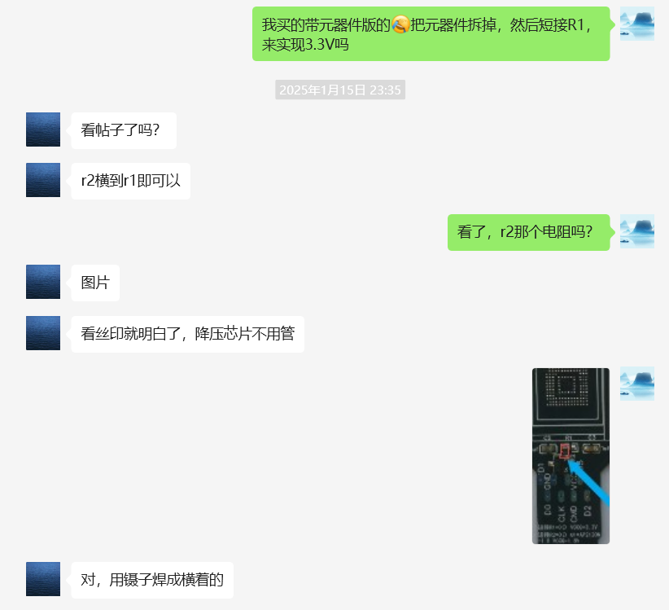
>
> 朋友圈帖子：
>
> EMMC-153/169-TF转接板：已往出货是不带元器件，应广大客户要求部分带元器件出货，至此有两种版。
>         首先简单普及一下EMMC芯片的基本知识，EMMC芯片核心供电电压vccq有两种1.8v和3.3v，根据个人使用情况90%的都是3.3V（代表品牌三星 闪迪 金士顿 国产的江波龙等）很少一部分是1.8v（典型代表东芝 ）随着5.1版本的普及会有很多1.8V甚至1.2V的出现。在此说的电压不是严格的电压，而是定义电平比较好，有个区间范围，灵活运用。
>         不是说你购买贵的就好，适合自己的最好。不带元器件版是默认3.0V，简单粗暴锡疙瘩短接r1=0 r2=∞就👌，带元器件版本是默认1.8V，r2=0 r1=∞根据自己实际需要反之；转接板可以让你的硬盘免开卡变成内存卡，焊盘多次焊接使用费了以后，还可以当isp飞线板已做了预留

原本 1.8V：

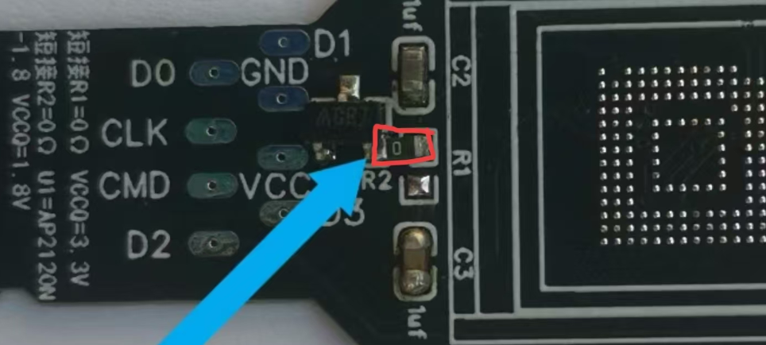

改 3.3V：

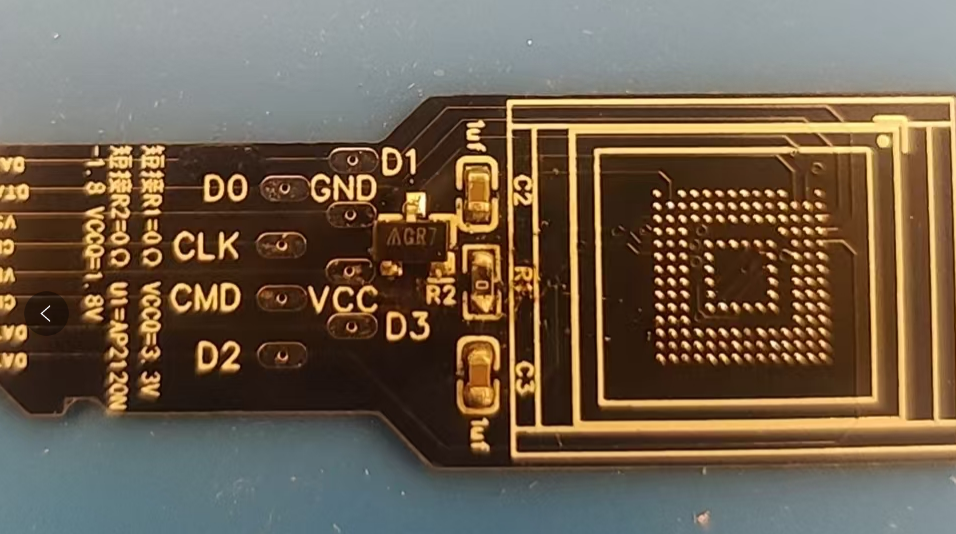

### 参考教程

> [请教一些亚瑟换emmc的问题-京东云、网心云、玩客云等PCDN云设备-恩山无线论坛](https://www.right.com.cn/forum/thread-8402119-1-1.html)
>
> 帖子讲的非常详细，我就是按照大佬的教程给设备接TTL备份完整固件，然后降级SSH开门，之后更换EMMC，中间有个EMMC容量不一致的问题困扰了我很久，最后研究很久(一度怀疑是自己EMMC没焊接好，反复焊接都是开机亮下红灯就灭)，后来将EMMC通过TF转接卡在diskgenius上查看发现有报分区表错误，然后醒悟应该是我原固件的前34扇区备份的分区表最后的数据分区是256G的，写入64G的EMMC中不适用导致报错了，通过diskgenius增减分区保存分区表解决此问题，按照这个方法理论上原固件可以在其它各种容量的EMMC中还原使用了
>
> [亚瑟（JDC AX1800PRO）折腾历程分享，适合有一定动手能力的同学-京东云、网心云、玩客云等PCDN云设备-恩山无线论坛](https://www.right.com.cn/forum/thread-8308574-1-1.html)
>
> [Actions-OpenWrt/Tutorial/JDCloud-AX1800-Pro_AX6600-Athena.md at main · lgs2007m/Actions-OpenWrt · GitHub](https://github.com/lgs2007m/Actions-OpenWrt/blob/main/Tutorial/JDCloud-AX1800-Pro_AX6600-Athena.md)


# 硬改 EMMC

### 查看 EMMC 寿命

```bash
root@JDBoxV2:~# var="$(cat /sys/kernel/debug/mmc0/mmc0\:0001/ext_csd)"
root@JDBoxV2:~# eol=${var:534:2};slc=${var:536:2};mlc=${var:538:2}
root@JDBoxV2:~# echo "EOL:0x$eol SLC:0x$slc MLC:0x$mlc"
EOL:0x01 SLC:0x04 MLC:0x01
```

EOL:0x01代表eMMC状态正常
SLC:0x04代表已使用30%-40%的寿命，预计剩余60%。
MLC:0x01江波龙这个型号的这个参数好像不变，不用看

貌似会先使用 SLC，SLC 用尽（0x0F），后，再开始用 MLC。SLC 性能高于 MLC。

### 合并分区文件

通过分区合并工具，将备份的26个分区文件合并为一个，实测几个工具的效果一致：

- bin merge

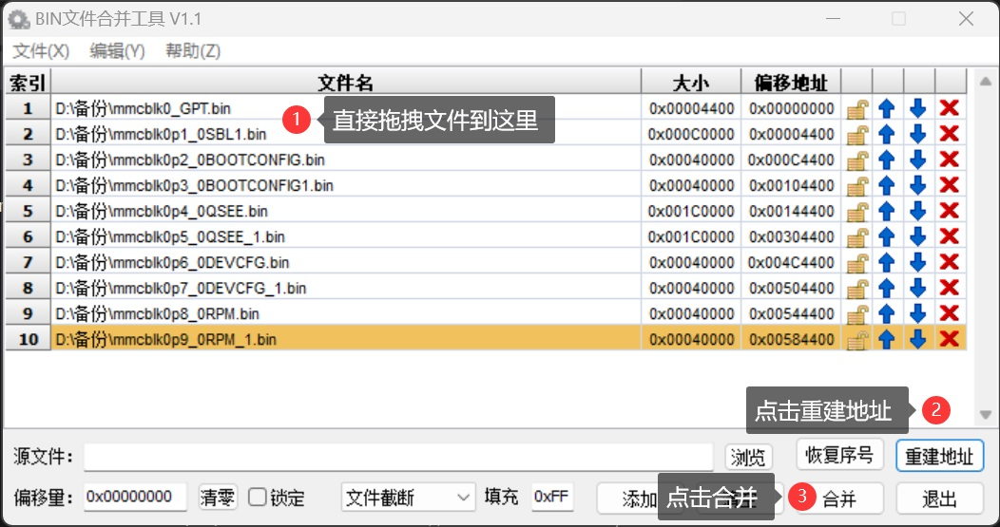

- WinHex（工具 - 文件工具 - 文件合并）

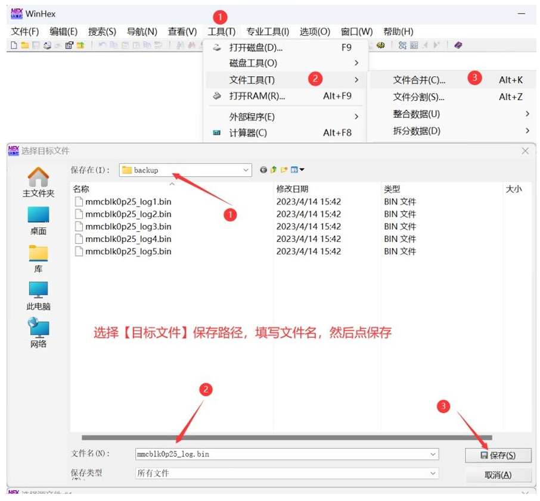

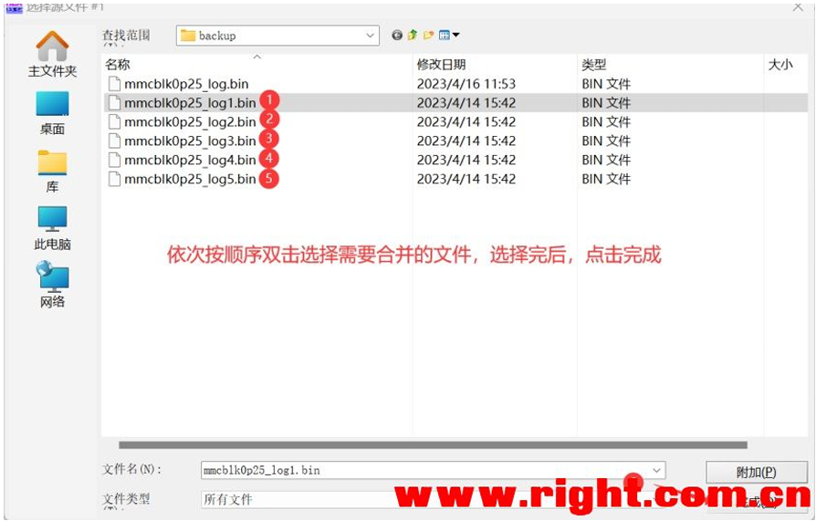

### 写入分区数据

将新的 emmc 焊接到 emmc 转 tf 上，插入 USD 读卡器（可能一般读卡器也行），插入电脑。此时读卡器灯亮，如果没亮，尝试换 USB 2.0 接口、重插 emmc 转 tf。

打开 WinHex，工具 - 打开磁盘，弹出窗口中看到 emmc，说明焊接没有问题。

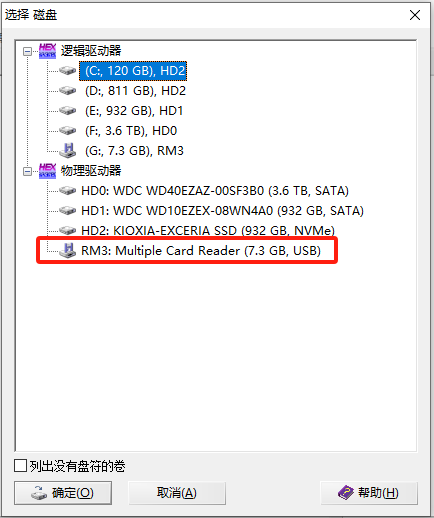

打开 WinHex，磁盘工具 - 磁盘克隆

- 源盘：合并后的分区文件
- 目标：emmc

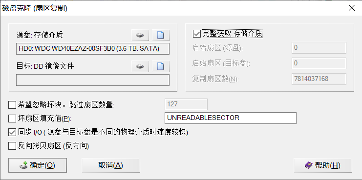

成功写入后，可以看到系统中出现了很多盘符

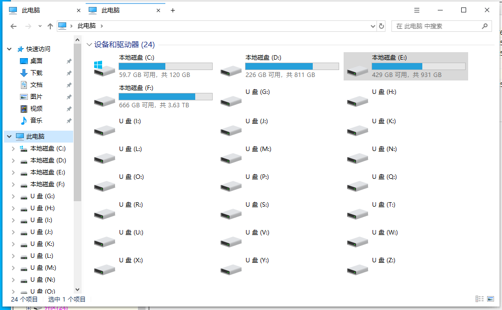

### 修复分区表

由于备份的分区文件来自原厂8G EMMC，直接写入64G EMMC 肯定是有问题的。

最简单的方式是，打开 Diskgenius，点击 RD3 盘，它会提示分区表有问题，点击更正即可，然后保存更改。

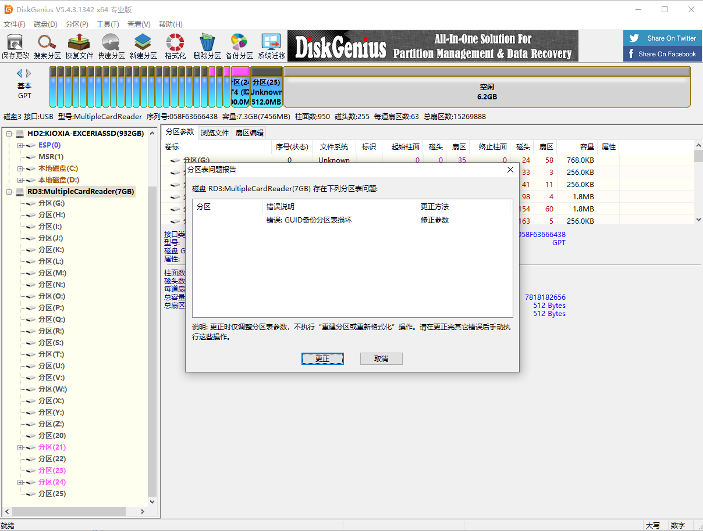

### 替换 EMMC

将 emmc 转 tf 和路由器上的 EMMC 取下，清洗焊盘/芯片后，将新 EMMC 焊接到 路由器。

冷却后插电开机测试，如果自动进入 9008，说明焊接或分区写入有问题。

# 硬改内存

直接用新的芯片替换旧芯片，冷却后插电开机测试，如果灯亮，说明没有问题。进入系统只能识别512MB，需要刷入CDT。

### 刷入 CDT

上传 CDT 文件到路由器

```bash
root@JDBoxV2:~# md5sum /tmp/cdt-Arthur_1G_DDR3.bin
6b0e4dd64171c6934e10255722bce062  /tmp/cdt-Arthur_1G_DDR3.bin
root@JDBoxV2:~# dd if=/tmp/cdt-Arthur_1G_DDR3.bin of=/dev/mmcblk0p10
1+1 records in
1+1 records out
548 bytes (548B) copied, 0.001859 seconds, 287.9KB/s
root@JDBoxV2:~# dd if=/tmp/cdt-Arthur_1G_DDR3.bin of=/dev/mmcblk0p11
1+1 records in
1+1 records out
548 bytes (548B) copied, 0.001867 seconds, 286.6KB/s
root@JDBoxV2:~# sync
```


# 焊接操作

### 风枪温度！！

风速：10（最低档）

温度：330，包括植锡、焊接到 emmc 转 tf、焊接到主板

拆原装芯片，原厂高温锡需要更高的温度：

- 拆 emmc：400
- 拆内存：420

> [!WARNING]
>
> 根据查阅资料温度不要超过 420，实测 480 温度焊盘掉点😭

温度比较玄学，但总体原则是：

- 拆芯片、洗焊盘、芯片要放助焊剂，有热传导、润滑的作用
- 风枪把周围吹几圈预热
- 拆芯片时，原厂高温锡可能需要吹一分钟左右；看到助焊剂比较干时，补助焊膏；看到助焊剂到处涌动时，用镊子轻推芯片，如果可以推动，保持吹风，把芯片夹下来，如果无法推动，
- 拆芯片、植锡时切忌对芯片硬拔

### 固定芯片

为防止小焊盘或者芯片在拖锡时移动，可使用固定夹具。

如果没有：

- 在纸板上，贴一条 1mm 厚的纸板条，这样可以在一个方向上限制它移动
- 可以在放芯片的位置点一点助焊剂（少点就行），用风枪吹化，这样芯片放上去会被粘住，有利于操作

### 拖锡

吸锡带的处理：

- 将吸锡带前端取一小段对折
- ~~用烙铁在其上面化一点锡，有利于热量传导~~
- ~~用烙铁将吸锡带压在纸板上几秒钟，给吸锡带预热~~
- 在焊盘上放一点助焊膏，可以非常丝滑地拖锡

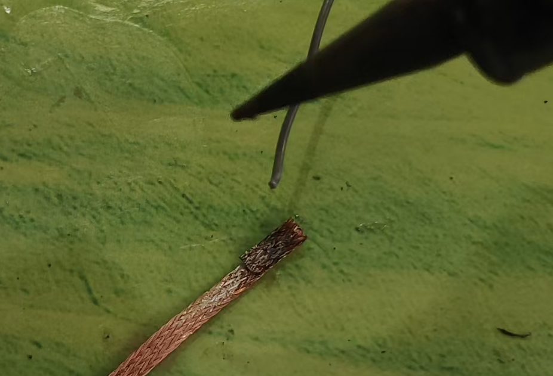

拖锡：

- 将焊盘或芯片放在纸板条旁边，往上面挤一些助焊剂（如果上面已经残留较多，可以不用）
- 一手拿吸锡带，一手拿烙铁，拖动方向与纸板条垂直。由于有纸板条的阻挡，拉的时候可以稍用力下压，推的时候就要减少下压。
- 拖锡时要根据阻力调整两手的力度，正常拖锡时，会感觉拖动非常顺滑，芯片也不容易被带着拖动。如果阻力较大，说明助焊剂不够，或者吸锡带热量不够、下方的锡点还没有融化，此时可以停在锡点上两三秒，如果有锡点融化、下沉的感觉，就可以正常拖锡了。
- 整个拖动过程力度都要轻，如果感觉吸锡带被锡粘住了，不可以硬拉，否则会把焊点拉掉，应该用烙铁头给他继续加热（最好用热风枪吹），将它轻轻的拿下来。

### 植锡

- 可以借助上面的纸板条，这样植锡网就能更好的跟芯片在同一平面。
- 最好使用弯头镊子，可以更好地压住植锡网。
- 焊锡膏一定不能太湿，抹焊锡膏的时候，呈现的样子应该是像玩具黏土一样，只是感觉是湿的，但是刮刀压没有雪花状的痕迹，方法：刮刀取焊锡膏之后，用纸包住按压 2-3次
- 风枪先往周围吹几圈，然后从一个角开始慢慢吹过去（左手持风枪，应该从右上角开始）
- 用嘴吹 10 下，抬起植锡网，正常情况，植锡网不会与芯片有任何粘连，如果有粘连，切忌硬翘下来，应抬起植锡网，用风枪将芯片吹掉下来。
- 观察到每个焊点都植锡成功了，如果有部分稍微有点歪，或者有一些像碎屑一样的薄薄的锡片，不要用镊子处理，用风枪一吹就可以完美解决

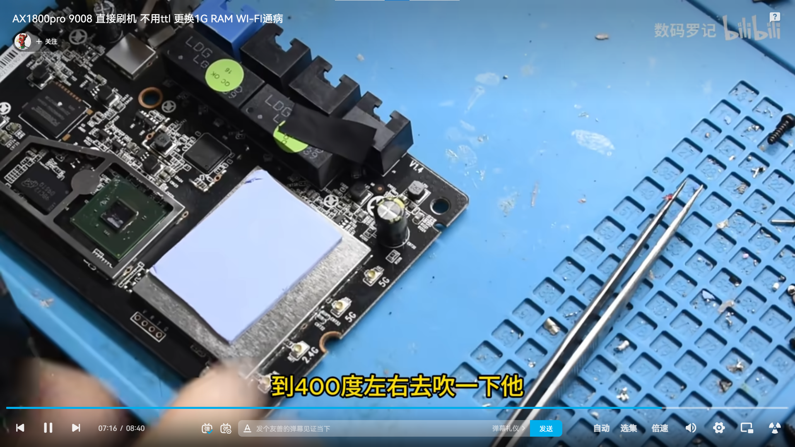

### 焊接

- 焊盘必须清理干净，往焊盘上挤一些助焊膏，用热风枪吹一下，尽量流到所有焊点上
- 根据 PCB 上的线框准确放上芯片，注意根据芯片右上角小圆点或触点辨别方向
- 使用热风枪竖直向下吹，注意另一只手拿镊子，防止芯片跑偏
- 看到芯片有一个下落的感觉，可以轻轻用镊子推芯片，如果有回弹，说明焊好了

> [!TIP]
>
> EMMC 可以根据触点判断方向，内存只能根据右上角原点判断，亚瑟摆放呈：PCB 正面朝上、内存离自己近的一侧，则内存右上角原点放于电路板右上角